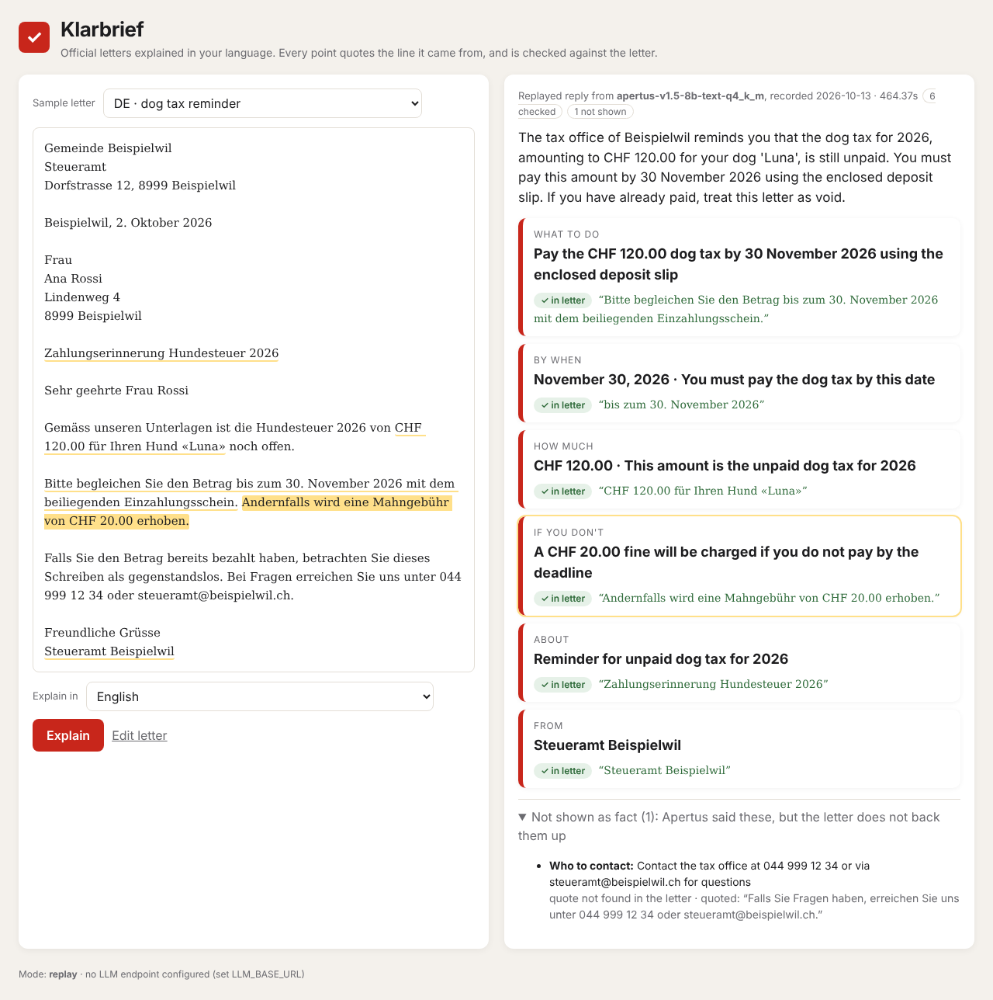

# Klarbrief

**Official Swiss letters explained in your language, with every point checked against the letter.**
Hack Apertus 2026 · Track 2B (Own Project) · built on Apertus 1.5.

A letter from the tax office, the commune or the migration office arrives in German, French or Italian. Klarbrief explains it in the reader's own language: what to do, by when, how much, and what happens if they do nothing. Apertus writes the explanation, and every point must quote the words of the letter it came from. Before anything is shown, Klarbrief finds that quote in the letter and checks that the date or amount the point states is actually written there. A point that fails is not shown as fact. The reader sees it separately, marked as not backed by the letter.



| | |
|---|---|
| Project code, `make run`, report | [`track_2b/`](track_2b/) |
| Technical report | [`track_2b/technical_report.md`](track_2b/technical_report.md) · [`Klarbrief_Report.pdf`](track_2b/Klarbrief_Report.pdf) |
| Evaluation letters (fictional, CC-BY-4.0) | [`track_2b/data/letters/letters.json`](track_2b/data/letters/letters.json) |
| Recorded model replies (re-scored by `make run`) | [`track_2b/data/results/`](track_2b/data/results/) |

## Run it

```bash
cd track_2b
cp .env.example .env          # set LLM_BASE_URL, LLM_API_KEY, LLM_NAME for any Apertus endpoint
make run                      # re-scores the recorded evaluation, explains three letters live, serves http://localhost:8000
make onprem                   # or: Apertus 1.5 8B in a local llama.cpp container, no internet at runtime
make test                     # unit tests
```

Without an endpoint, `make run` still re-scores the recorded evaluation, and the UI replays the recorded replies for the sample letters, labelled as replayed.

## Why it can run anywhere

The app uses the Python standard library only, with no packages installed at build or run time. It talks to Apertus through the OpenAI-compatible API, so it runs against a local llama.cpp server (on-premise or air-gapped), a Swiss cloud endpoint, or the hackathon's CSCS endpoint, with three environment variables.

## License

Code: Apache-2.0. Documentation and the evaluation letters: CC-BY-4.0 (the letters are also offered under CDLA-Permissive-2.0). All names, addresses, communes and case numbers in the letters are fictional.
