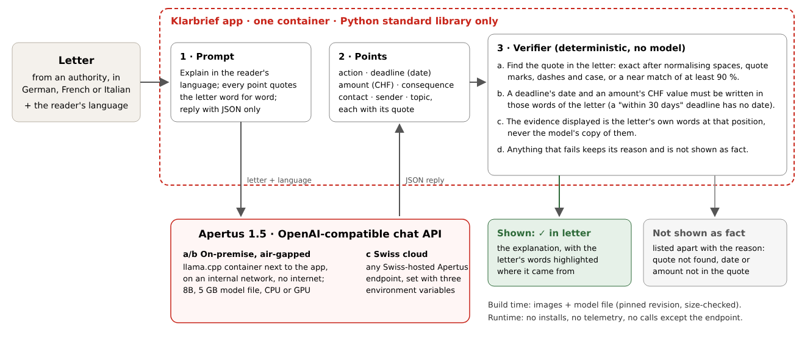

# Technical report — Klarbrief

- **Track:** Track 2B — Klarbrief: official Swiss letters in your language
- **Event:** Online
- **Team:** Klarbrief — Jannet Akanksha Ekka
- **Demo:** __DEMO_URL__ · code: https://github.com/JannetEkka/klarbrief

## 1. Summary

People in Switzerland receive official letters (tax reminders, permit renewals, fines, premium subsidies) in German, French or Italian. 27% of residents do not hold a Swiss passport [1], and many newcomers cannot yet read the language of their commune well enough to catch a deadline. A language model can explain such a letter, but it can also state a deadline that is not in it, and the reader has no way to tell. **Klarbrief** has Apertus 1.5 explain the letter in the reader's language, as a short summary plus points: what to do, by when, how much, what happens otherwise, and who to contact. **Every point must quote the letter**, and a deterministic verifier finds that quote in the letter, checks that a deadline's date or an amount's value is written there, and rejects deadlines that predate the letter. Only points that pass are shown, with the letter's own words highlighted. The rest are listed apart, with the reason. __HEADLINE__

## 2. Architecture

1. **Prompt** (`src/klarbrief/explain.py`). One system prompt asks for a JSON object: a summary in the reader's language, and lists of actions, deadlines (ISO date or `null`), amounts (CHF), consequences and contacts, each with a `quote` copied from the letter. It also says that the letter's own date is not a deadline and that dates must not be calculated.
2. **Apertus 1.5** answers through the OpenAI-compatible chat API with `temperature 0` and JSON mode where the server supports it (llama.cpp does; otherwise the JSON is parsed from the text, and the run says so).
3. **Verifier** (`src/klarbrief/verify.py`, about 200 lines, no model). (a) It locates each quote after normalising whitespace, typographic quotes, dashes and case, or accepts a near match of at least 90% similarity. It then aligns to whole words and shows *the letter's* words at that position, never the model's copy. (b) A deadline's date must be written within the quoted words (±25 characters). A relative deadline ("innert 30 Tagen") must come with `date: null`. (c) An amount's CHF value must be written within the quoted words. (d) A deadline earlier than the letter's own dateline is rejected as already passed. Dates and amounts are parsed in DE/FR/IT/EN with Swiss number formats (`CHF 1'250.50`, `Fr. 85.–`).
4. **UI** (`src/klarbrief/server.py`, `static/index.html`). One page served by the Python standard library. The reader pastes a letter, picks a language (15 offered, including Albanian, Tigrinya, Ukrainian, Tamil and Romansh), and sees cards. Hovering a card highlights its words in the letter. Rejected points sit in a collapsed "Not shown as fact" list with their reasons.

### Target architecture (mandatory)

Klarbrief is deployable as **(a) on-premise** and **(b) air-gapped**, and is ready for **(c) a sovereign Swiss cloud**.

- **(a)/(b)** `make onprem` starts two containers. One is the official llama.cpp server with a 5 GB Apertus 1.5 8B GGUF. It sits on an `internal: true` Docker network with no route to the internet, and the model file is mounted read-only. The other is the app. The model file is the only build-time download (pinned revision, size-checked). At runtime nothing is installed or fetched, and nothing leaves the machine. Every result in this report was produced this way on a 4-core CPU with no GPU.
- **(c)** The app needs only `LLM_BASE_URL`, `LLM_API_KEY` and `LLM_NAME`, so it can be pointed at a Swiss-hosted Apertus endpoint. Infomaniak serves Apertus v1.5 70B through an OpenAI-compatible API [2], and Swisscom offers Apertus to business customers [3]. We have not run Klarbrief against those paid endpoints, so (c) is supported by the interface but untested.
- **Dependencies:** runtime is Python 3.12 standard library only (the app image installs nothing) plus llama.cpp's published image. Build time is Docker. Development only: `markdown` and Chromium to build this PDF.

## 3. Use of Apertus

- **Model:** Apertus 1.5 8B. On-premise we use a community text-only conversion of `swiss-ai/Apertus-v1.5-8B`, quantised to Q4_K_M GGUF (`Colby/apertus-v1.5-8b-text-Q4_K_M-GGUF@248ec68`, Apache-2.0). Track 2 allows community builds [4]. Image and audio input are not used.
- **How it is used:** inference only, one call per letter, `temperature 0`, `seed 0`, max 1,200 output tokens. No fine-tuning.
- **Where it runs:** llama.cpp server `--jinja` (the GGUF's embedded Apertus chat template), context 8,192, 4 parallel slots, 4 CPU threads.
- **Why Apertus:** its multilingual training (1,000+ languages) covers the reader languages newcomers actually speak, and its open weights, data and licence let a commune run it on its own hardware. Both are what this use case needs.

## 4. Data

`data/letters/letters.json` holds **20 fictional official letters** written for this project: 8 German, 6 French, 6 Italian. They cover tax and fee reminders, permit renewals, parking fines, premium subsidies, a job-centre appointment, school registration and information-only notices. Names, communes ("Beispielwil", "Montexemple", "Esempiano"), addresses and case numbers are invented. No personal data is involved. Each letter is labelled with its true deadlines (calendar dates by which the reader must act) and every CHF amount it states. A unit test checks the labels against the text.

The letters deliberately contain traps a careless reader, human or model, falls for:
- the letter's own date;
- start dates ("ab dem 6. Januar 2027");
- expired dates ("am 31. März 2026 abgelaufen");
- the date of an offence;
- relative deadlines ("innert 30 Tagen", "dans les 30 jours", "entro 30 giorni"), which have no calendar date;
- three information-only letters.

Licence: CC-BY-4.0 (also offered under CDLA-Permissive-2.0). Every raw model reply is recorded in `data/results/*.jsonl`.

## 5. Evaluation

**Task:** explain each of the 20 letters in English, and again in Ukrainian (40 replies), then compare what would be shown with the labels.

**Baseline:** the same model's points shown *without* the verifier, which is what a plain "explain this letter" app displays.

__EVAL_TABLE__

__EVAL_TEXT__

## 6. Limitations

- **The verifier checks provenance, not interpretation.** A point whose quote and date are really in the letter, but which misreads them (a start date presented as a deadline), passes checks (a)–(c). Rule (d) catches only one such pattern, expired dates. We added it during development after seeing a reply that listed the expired original deadline of letter de-04, so it is not an unseen-data result.
- **Strictness costs recall.** A correct point whose quote the model paraphrased is hidden. __RECALL_NOTE__
- **The explanation text itself is not verified.** The summary and each point's wording in the reader's language come from the model. The checks cover the quote, date and amount, not the translation. We did not have native speakers rate the Ukrainian output.
- **Small, synthetic test set.** 20 letters written by us, not real correspondence. Real letters bring scans, tables, payment slips (QR-bill) and legal boilerplate.
- **Quantised community build on CPU.** The numbers are for the Q4_K_M text-only 8B model, not the official BF16 checkpoint or the 70B. On a 4-core CPU one letter takes __SECONDS__ s. A single GPU, or a hosted endpoint, takes seconds. llama.cpp's batched decoding is not bit-identical across batch sizes, so re-running can change individual replies slightly. Re-scoring the recorded replies is exact.
- **Not legal advice.** The UI points readers to the contact named in the letter.

## 7. Reproducibility

- `make test`: 21 unit tests (standard library `unittest`) in the app container.
- `make run`: re-scores every recorded reply in `data/results/` (exact, no model needed), explains three letters live if an endpoint is configured, and serves the UI. Without an endpoint, the UI replays recorded replies for the sample letters, labelled as replayed.
- `make onprem`: downloads the pinned model and runs the whole stack offline. `make eval` regenerates `data/results/<model>.jsonl` (resumable).
- Hardware for the reported run: 4 vCPU, 16 GB RAM, no GPU; llama.cpp `ghcr.io/ggml-org/llama.cpp:server` (pulled 13 Oct 2026). Commit: __COMMIT__.

## 8. Next steps

- **Input:** photos and PDFs through Apertus 1.5's image input or local OCR, and the Swiss QR-bill (amount and due date come from its machine-readable code, a free cross-check).
- **Interpretation checks:** classify each date in the letter (letter date, start, expiry, deadline) with cheap rules and keep the model honest against them, closing the gap in Limitation 1.
- **Evaluation:** real, consented letters from a commune's integration office; native-speaker ratings of the explanations; the official BF16 8B and the 70B.
- **Pilot:** one commune's counter staff, on their existing hardware, where the "not shown as fact" list doubles as a review queue.

## License

Code: Apache-2.0. This report, the docs and the letters: CC-BY-4.0. All Hack Apertus projects are open-sourced.

## References

1. Avenir Suisse, "Nearly three in ten without a Swiss passport", based on FSO data, end of 2024. https://www.avenir-suisse.ch/en/blog-nearly-three-in-ten-without-a-swiss-passport/
2. Mastra model provider docs, Infomaniak (OpenAI-compatible API, `swiss-ai/Apertus-v1.5-70B`). https://mastra.ai/models/providers/infomaniak
3. Artificial Intelligence News, "Switzerland releases its own fully open AI model", Sept 2025. https://www.artificialintelligence-news.com/news/switzerland-releases-its-own-fully-open-ai-model/
4. Hack Apertus FAQ, "Is a community text-only GGUF of Apertus v1.5 acceptable?". https://hackapertus.ch/faq
5. Apertus team, "Apertus: Democratizing Open and Compliant LLMs", 2025. https://arxiv.org/abs/2509.14233
